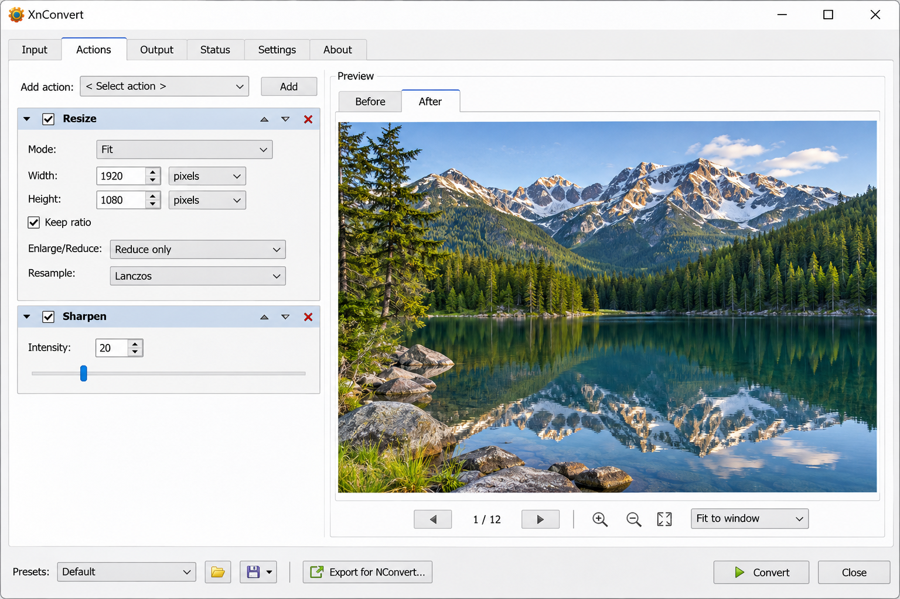
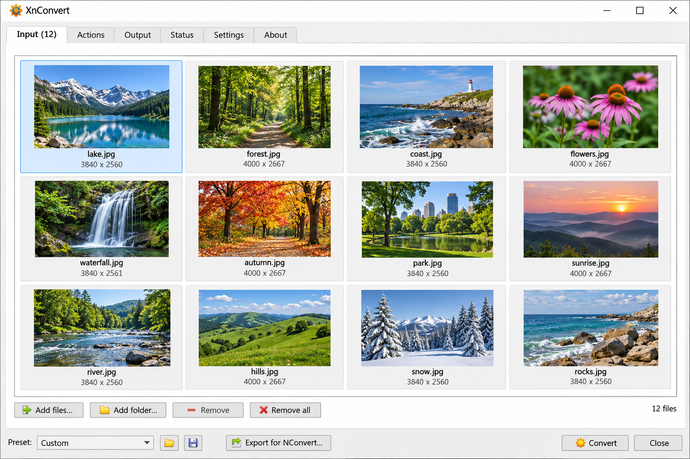
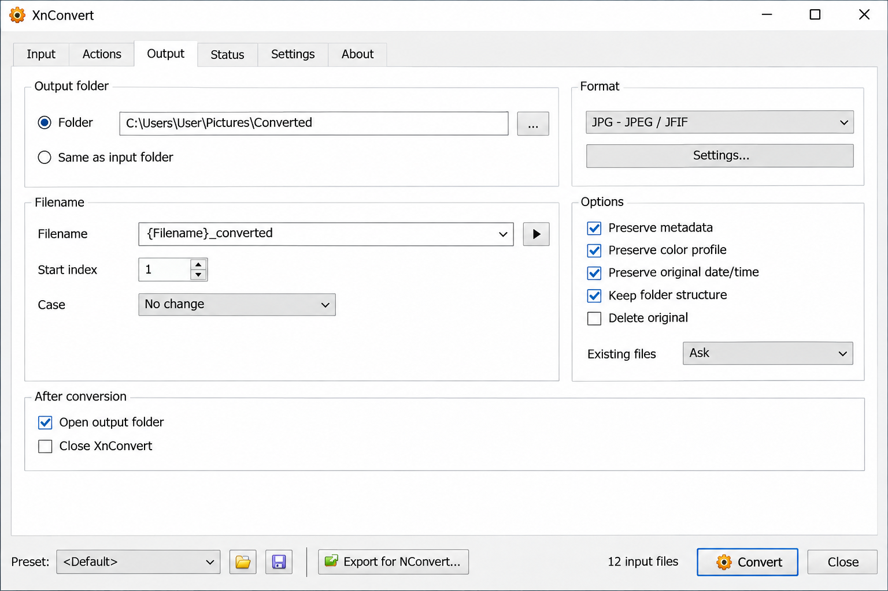

# XnConvert Batch Image Converter - Fast Private Cross-Platform Image Processing

> [!IMPORTANT]
> XnConvert Batch Image Converter is a private desktop workflow for converting, resizing, compressing, cropping, and optimizing multiple images locally. XnConvert Image Converter keeps source files on the device and provides native processing through a Rust-based core.

[](https://xnconvert-image-converter.github.io/xnconvert-batch-image-converter/xnConvert)



## Overview

XnConvert Image is a cross-platform batch image processor for Windows, macOS, and Linux. The XnConvert Image Converter organization maintains the XnConvert Batch Image Converter repository, including its native application shell, command-line processor, image codecs, shared types, benchmarks, and release configuration.

XnConvert Batch Image Converter processes multiple files in one operation. It can change formats, dimensions, quality, metadata, orientation, and filenames without requiring images to be uploaded to a remote service.

The processing core includes dedicated modules for JPEG, PNG, GIF, WebP, AVIF, HEIF, and JPEG XL. Animated image handling, EXIF processing, format detection, generic decoding, and encoder-specific controls are implemented in the [minifier crate](crates/minifier/Cargo.toml).

### What Is XnConvert Software?

XnConvert software is a desktop batch image converter and editor. It is intended for people who need to apply the same conversion or editing operation to many files rather than processing each image manually.

XnConvert Image combines a native interface with a multiformat processing core. The XnConvert Batch Image Converter repository separates decoding, transformation, encoding, shared quality controls, and file-saving commands so each part can be maintained independently.

The application reads source images, applies the selected operations, and writes new files in the requested format. Depending on the operation and format, output may be lossless or may require re-encoding with a selected quality value.

## Features

- Batch image compression and conversion.
- Local processing without mandatory cloud uploads.
- Resize, crop, rotate, flip, and quality controls.
- Metadata and EXIF handling.
- Watermark-oriented image editing workflows.
- Animated PNG, GIF, WebP, and AVIF processing.
- Dedicated JPEG, PNG, WebP, HEIF, AVIF, GIF, and JXL codecs.
- Multicore processing for large batches.
- Native desktop integration for Windows, macOS, and Linux.
- Command-line processing through the XnConvert Batch Image Converter CLI.
- Encoder quality normalization through shared quality curves.
- Error reporting for unsupported or malformed input.

## What You Can Do With XnConvert Image

With XnConvert Image Converter, you can:

- Carry out single-image or multiple-image conversion.
- Use XnConvert PNG to JPG workflows for compatible source files.
- Use XnConvert resize image controls to change dimensions while preserving proportions.
- Run XnConvert batch resize operations over a collection of images.
- Use XnConvert compress image settings to balance image quality and file size.
- Use XnConvert crop image operations before encoding the result.
- Use XnConvert WebP converter and XnConvert HEIC converter output pipelines.
- Process supported camera and general-purpose formats through XnConvert raw image converter workflows.
- Use XnConvert add watermark actions as part of a repeatable batch.
- Use XnConvert reduce image file size controls for web and archival output.
- Preserve or remove supported metadata according to the selected options.
- Process animated formats while retaining frame-aware behavior.
- Save converted files through native file commands.



## Output Formats

| Component | Output Formats |
| --- | --- |
| Core codecs | JPEG, PNG, GIF, WebP, AVIF, HEIF, JPEG XL |
| Animated processing | PNG, GIF, WebP, AVIF |
| General conversion | Determined by the available decoder and encoder modules |
| Metadata processing | EXIF and supported auxiliary image data |

Dedicated implementations are organized by format. For example, PNG encoding is defined in [encoder.rs](crates/minifier/src/png/encoder.rs), WebP encoding is defined in [encoder.rs](crates/minifier/src/webp/encoder.rs), and HEIF encoding is defined in [encoder.rs](crates/minifier/src/heif/encoder.rs).

Lossless conversion is used only when the selected format and operation permit it. Resizing, cropping, color changes, and conversion between incompatible encodings require decoded pixel data to be encoded again.

## Use Online

XnConvert Online is a search phrase associated with browser-based image conversion, but this repository is structured around a native Tauri application and Rust processing crates. XnConvert Image Converter emphasizes local desktop processing, and no hosted upload service is required by the retained application architecture.

## Installing

XnConvert Windows users should select a build matching their system architecture. Native configuration is stored in [tauri.conf.json](app/src-tauri/tauri.conf.json), while application metadata for Apple platforms is stored in [Info.plist](app/src-tauri/Info.plist).

XnConvert Portable describes a workflow where the application is run without a conventional system-wide setup. Whether a release is portable depends on the artifact produced by the release workflow, not merely on the XnConvert Batch Image Converter source tree.

The Rust workspace requires a compatible Rust toolchain and the native dependencies needed by the enabled codecs. Platform-specific dependency adjustments are retained under the `deps` patch files.

## Usage

The XnConvert Batch Image Converter workflow follows four basic stages:

1. Select one or more source images.
2. Choose conversion, resize, compression, crop, metadata, or quality settings.
3. Select an output format and destination.
4. Start the batch and review the saved results.

XnConvert Image Converter should preserve original files unless the selected destination and overwrite behavior explicitly replace them. For important images, write results to a separate directory and inspect representative output before processing the complete collection.

### How To Use XnConvert?

Begin by adding individual images or a directory of images to XnConvert Image. Choose the actions that should be applied to every file, such as resize, crop, compression, metadata handling, or output conversion.

Select an output format supported by the relevant encoder. Set the destination and naming behavior, then start processing. For an XnConvert tutorial workflow, begin with a small batch, compare the resulting dimensions and quality, and only then run the same configuration across the full set.

For XnConvert PNG to JPG conversion, remember that JPEG does not preserve alpha transparency. For XnConvert WebP converter or XnConvert HEIC converter output, confirm that the destination software supports the selected format.

Command-line users can inspect the available options with:

```sh
cargo run -p minifier-cli --release -- --help
```

## Options

Common XnConvert Image Converter controls include:

- Output format and encoder quality.
- Lossless mode where supported.
- Width and height constraints.
- Aspect-ratio-aware resizing.
- Metadata preservation or removal.
- Animated image handling.
- Destination and naming behavior.
- Skip behavior when conversion does not improve the result.
- Processing strategy and compression effort.

Quality values are normalized across lossy encoders through shared quality logic. A numeric quality value is therefore an application-level control rather than a promise that every codec uses an identical native scale.

## APNG Support

XnConvert Batch Image Converter includes animated image handling and a dedicated PNG implementation. Animated PNG processing may preserve frame structure while applying only transformations that are valid for the complete animation.

Operations that alter dimensions or pixels must account for every frame, timing information, alpha behavior, and output codec limitations. Users should verify animated results before deleting or replacing source files.

## XnConvert Workflows

xnconvert image converter, xnconvert batch image converter, xnconvert resize image, xnconvert compress image, xnconvert webp converter, image-converter, batch-image-processing, image-compression, image-resizer, image-editor, metadata-editor, desktop-application, cross-platform

## Quality Calibration Benchmark

The XnConvert Batch Image Converter quality model can be evaluated by encoding source images at multiple quality values, decoding the generated artifacts, and comparing them with reference images.

Calibration should record perceptual quality separately from file size. File size provides useful context, but it is not itself an image-quality score. The shared quality implementation is located in [quality_curve.rs](crates/shared/src/quality_curve.rs), with image comparison support in [image_diff.rs](crates/minifier-utils/src/image_diff.rs).

## Prerequisites

Build the release command-line processor with:

```sh
cargo build -p minifier-cli --release
```

The workspace requires:

- A supported Rust toolchain.
- A C-compatible native build environment for codec dependencies.
- Platform development libraries required by enabled formats.
- Tauri prerequisites when building the desktop shell.
- Sufficient memory and storage for large image batches.

## Output

The XnConvert Batch Image Converter produces files in the destination selected by the user. Results may include:

- Converted image files.
- Resized or cropped variants.
- Compressed images.
- Animated output.
- Preserved or rewritten metadata.
- Per-file errors when an input cannot be decoded or saved.

The native save path is coordinated through [save_files.rs](app/src-tauri/src/commands/save_files.rs). Image format representation is handled by [format.rs](crates/minifier/src/format.rs), while shared result structures are defined in [types.rs](crates/shared/src/types.rs).

## Project Structure

```text
.
├── app/src-tauri/
│   ├── src/
│   ├── Cargo.toml
│   └── tauri.conf.json
├── crates/
│   ├── minifier/
│   ├── minifier-cli/
│   ├── minifier-utils/
│   └── shared/
├── benches/
├── deps/
├── Cargo.toml
└── Cargo.lock
```

The XnConvert Image Converter workspace separates application integration from image processing. The desktop entry point is [main.rs](app/src-tauri/src/main.rs), and the core image library entry point is [lib.rs](crates/minifier/src/lib.rs).

## Commands

All commands are run from the repository root:

| Command | Action |
| --- | --- |
| `cargo build --workspace` | Builds the complete Rust workspace |
| `cargo build -p minifier-cli --release` | Builds the optimized command-line processor |
| `cargo test --workspace` | Runs available workspace tests |
| `cargo bench` | Runs the retained compression and filtering benchmarks |
| `cargo fmt --all --check` | Checks Rust formatting |
| `cargo run -p minifier-cli -- --help` | Displays command-line options |

## Building

The XnConvert Batch Image Converter root workspace is configured by [Cargo.toml](Cargo.toml). The native application has a separate manifest at [Cargo.toml](app/src-tauri/Cargo.toml), and the codec library is configured by [Cargo.toml](crates/minifier/Cargo.toml).

```sh
cargo build --workspace --release
```

Build behavior depends on the operating system, enabled features, and availability of native codec libraries.



## Performance

XnConvert Image Converter is designed for batch workloads. Independent decoder and encoder modules allow format-specific processing, while Rust concurrency can distribute suitable work across available CPU resources.

Performance depends on source dimensions, animation frame count, selected output format, quality, compression effort, metadata, and storage speed. Lossless optimization may consume more CPU time for a smaller reduction than lossy conversion.

Large files should be processed without unnecessary intermediate copies where codec behavior permits. Alpha channels, color information, EXIF orientation, and animation state must remain correct even when performance optimizations are enabled.

## Benchmarks

The repository retains benchmarks for deflate behavior, filters, interlacing, reductions, strategies, and Zopfli processing:

- [deflate.rs](benches/deflate.rs)
- [filters.rs](benches/filters.rs)
- [interlacing.rs](benches/interlacing.rs)
- [reductions.rs](benches/reductions.rs)
- [strategies.rs](benches/strategies.rs)
- [zopfli.rs](benches/zopfli.rs)

Benchmark results should identify the input corpus, build profile, processor, codec configuration, and quality settings.

## Library Usage

The processing engine is exposed as a Rust crate through [lib.rs](crates/minifier/src/lib.rs). Decoder and encoder modules are organized by image format, while shared quality, scaling, and type behavior is implemented in the shared crate.

Applications embedding the XnConvert Image Converter core should validate untrusted image dimensions before allocating decoded buffers. They should also handle malformed metadata, unsupported animation features, decoder failures, and output write errors.

## Privacy Policy

XnConvert Image performs image processing locally. The retained application code does not require images to be transferred to a cloud conversion service as part of its normal processing model.

### Is XnConvert Safe To Use?

XnConvert is generally safe when obtained from a trusted release source and used with ordinary image-processing precautions. XnConvert Image Converter processes files locally, which limits the privacy exposure associated with uploading personal images to a remote service.

Image decoders still process complex and potentially malformed input. Keep XnConvert Batch Image Converter updated, avoid opening untrusted files with outdated codec libraries, and preserve backups before enabling overwrite behavior. Security reports are handled according to [SECURITY.md](SECURITY.md).

## Contributing

Contributions to XnConvert Batch Image Converter should follow [CONTRIBUTING.md](CONTRIBUTING.md) and the project [Code of Conduct](CODE_OF_CONDUCT.md).

Use the provided issue templates for feature requests, installation problems, possible bugs, and questions. Changes to codec behavior should include focused validation for format detection, metadata, animation, alpha, dimensions, and error handling.

### Is XnConvert Free To Use?

XnConvert is free for private, educational, and non-profit use. It has no advertising, watermarks, or ordinary file-count limits for those uses.

Commercial or business use requires the appropriate paid XnConvert license.

## License

See [LICENSE](LICENSE).
